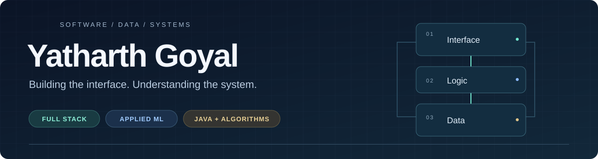

<picture>
  <source media="(max-width: 600px)" srcset="assets/profile-banner-mobile.svg">
  
</picture>

  <a href="#selected-projects">Projects</a> &nbsp; / &nbsp;
  <a href="#engineering-toolkit">Toolkit</a> &nbsp; / &nbsp;
  <a href="https://www.linkedin.com/in/yatharth-goyal-ab0a8b326/">LinkedIn</a> &nbsp; / &nbsp;
  <a href="https://leetcode.com/u/yatharth_goyal/">LeetCode</a> &nbsp; / &nbsp;
  <a href="mailto:yatharthgoyal657@gmail.com">Email</a>

I'm **Yatharth**, a B.Tech Information Technology student building web applications, exploring applied machine learning, and practicing algorithms in Java. I like projects where the interface, API, and data model have to work together: allocating a hospital bed, managing a marketplace listing, or explaining a model's prediction.

My current focus is **full-stack engineering, reliable backend workflows, and useful ML applications**. I'm interested in software engineering and applied ML internship opportunities.

## Selected projects

<table>
<tr>
<td width="50%" valign="top">
<h3>01 / AegisED</h3>

<strong>Emergency operations &amp; decision support</strong>

Models the workflow from registration to discharge, with doctor and bed allocation, role-based access, audit trails, and human-reviewed ML recommendations.

<code>React</code> <code>Express</code> <code>PostgreSQL</code> <code>FastAPI</code>

<strong>Explore:</strong> resource consistency, transactions, and backend authorization.

<a href="https://github.com/YT-PRO12/AegisED">Source &amp; architecture →</a>

Educational engineering demo; ML is not clinically validated.

</td>
<td width="50%" valign="top">
<h3>02 / CampusHub + MERN</h3>

<strong>From React fundamentals to a full-stack marketplace</strong>

Seven structured sections connect frontend exercises, backend APIs, and MongoDB labs to CampusHub: sessions, ownership checks, search, pagination, and listing transitions.

<code>React</code> <code>Node.js</code> <code>Express</code> <code>MongoDB</code>

<strong>Explore:</strong> API/database tests, browser workflows, and GitHub Actions.

<a href="https://github.com/YT-PRO12/MERN-Full-Stack-Engineering./">Source &amp; local demo →</a>

Runnable locally with synthetic listings; not deployed online.

</td>
</tr>
<tr>
<td width="50%" valign="top">
<h3>03 / Grid Flex</h3>

<strong>Energy scheduling &amp; optimization</strong>

Coordinates production jobs, solar, battery storage, and grid imports with mixed-integer optimization. Compares cost/carbon strategies and independently checks the resulting schedules.

<code>Python</code> <code>SciPy / HiGHS</code> <code>JavaScript</code>

<strong>Explore:</strong> mathematical constraints, scenario analysis, and explainable trade-offs.

<a href="https://github.com/YT-PRO12/Grid-Flex">Source &amp; scenarios →</a>

Local prototype using synthetic scenarios; no physical equipment control.

</td>
<td width="50%" valign="top">
<h3>04 / EduPredict AI</h3>

<strong>Student performance &amp; early-warning insights</strong>

Connects student assessments and a machine-learning pipeline to an interactive web dashboard for exploring academic risk and intervention-oriented insights.

<code>React</code> <code>FastAPI</code> <code>scikit-learn</code> <code>SQLite</code>

<strong>Explore:</strong> model integration, prediction APIs, and data-driven interfaces.

<a href="https://github.com/YT-PRO12/EduPredictAI">Source &amp; setup →</a> · <a href="https://edu-predict-ai-64gq.vercel.app/">Frontend preview</a>

React frontend with a Python prediction API.

</td>
</tr>
</table>

**More applied work**

- **[FleetGuard AI](https://github.com/YT-PRO12/FleetGuard-AI)** — predictive-maintenance classification with preprocessing pipelines, class-imbalance handling, and a Streamlit interface. Uses the synthetic AI4I benchmark.
- **[WindCtrl Validator](https://github.com/YT-PRO12/windctrl-validator)** — CSV validation, power-tracking tolerance checks, and engineering reports from synthetic controller observations.

## Engineering toolkit

| Area | Technologies used across my repositories |
| :--- | :--- |
| **Languages** | Java · JavaScript · Python · SQL |
| **Interfaces** | React · HTML · CSS · Tailwind CSS · Vite |
| **APIs & data** | Node.js · Express · FastAPI · PostgreSQL · MongoDB / Mongoose · SQLite |
| **ML & analysis** | pandas · NumPy · scikit-learn · Matplotlib · SciPy · Streamlit |
| **Verification & delivery** | Git · GitHub Actions · pytest · Vitest · Playwright · Docker |

## Foundations I keep building

| Repository | What I'm practicing |
| :--- | :--- |
| **[Java DSA](https://github.com/YT-PRO12/DSA-Java-Interview-Prep)** | Patterns, invariants, edge cases, and complexity — from arrays and strings through trees and BSTs. |
| **[Web foundations](https://github.com/YT-PRO12/HTML-CSS-JavaScript)** | Semantic HTML, responsive CSS, DOM interactions, and JavaScript fundamentals. |
| **[React projects](https://github.com/YT-PRO12/React-Projects)** | Components, hooks, state, routing, and API integration. |
| **[Data science & ML](https://github.com/YT-PRO12/Data-Science-ML-Journey)** | Python, data preparation, exploratory analysis, and model evaluation. |

## How I approach the work

- **Understand the rules first.** Write down valid states, ownership, and edge cases before building the interface.
- **Follow the data.** Trace a request from the screen through validation and storage to the response.
- **Make changes reviewable.** Keep commits focused, document setup, and add regression coverage for behavior that can break.
- **Explain the result.** Distinguish a local demo from a deployment, and a model score from real-world validation.

**Currently building:** EvalForge, an assessment and evaluation platform under active development in a private repository. Alongside it, I'm strengthening Java problem-solving, backend reliability, and system-design fundamentals.

---

  <strong>Let's build something useful.</strong> 
  Interested in full-stack development, applied ML, and engineering tools.  
  <a href="https://www.linkedin.com/in/yatharth-goyal-ab0a8b326/">Connect on LinkedIn</a> &nbsp; · &nbsp;
  <a href="mailto:yatharthgoyal657@gmail.com">yatharthgoyal657@gmail.com</a>

